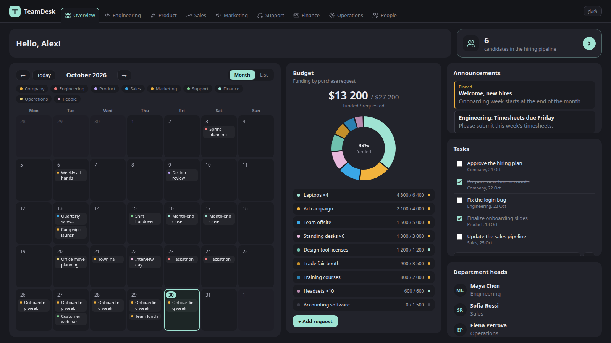
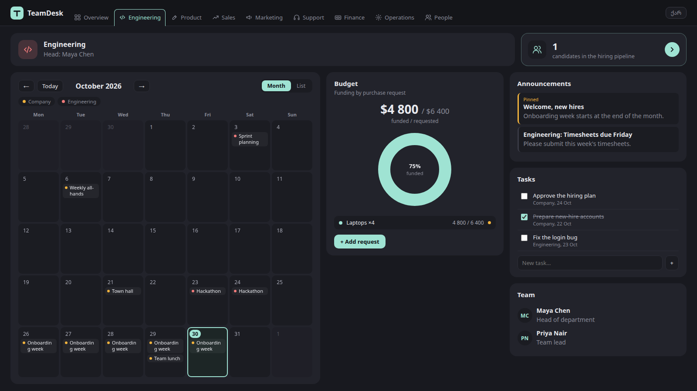
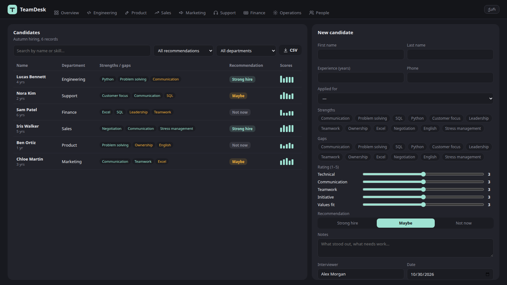
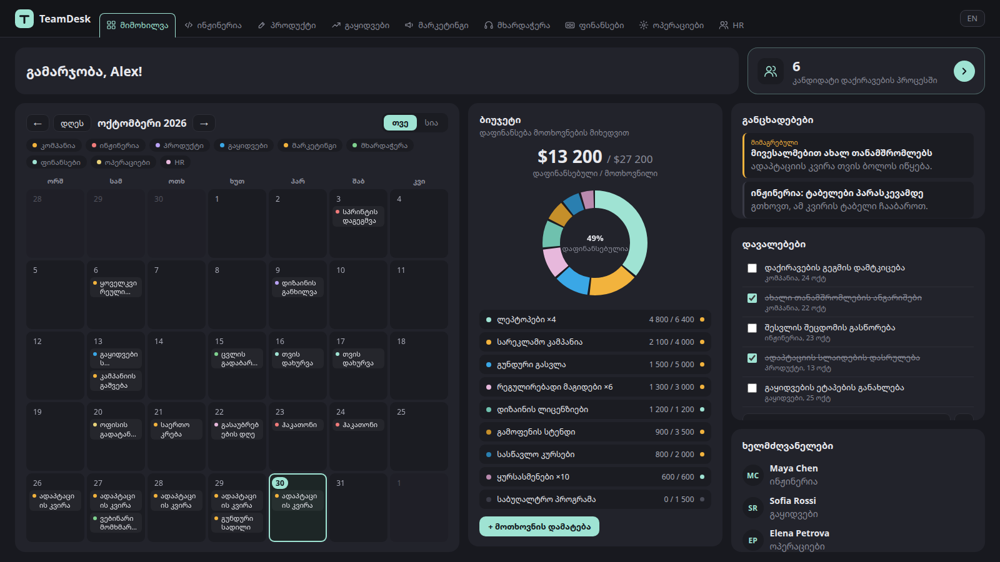
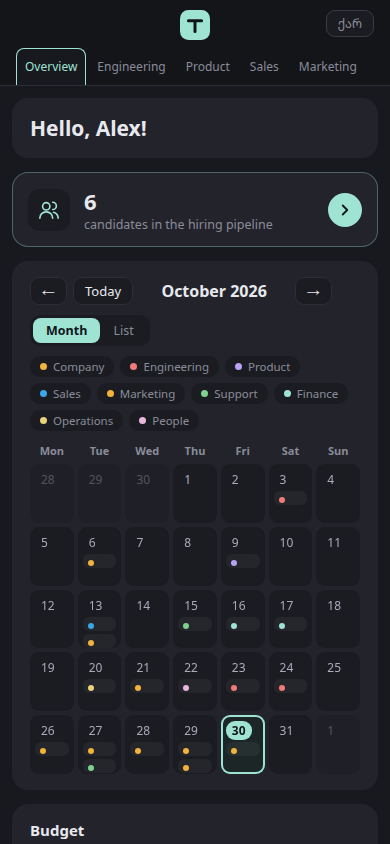

# TeamDesk

An HR dashboard for a small company, in one HTML file. It has a shared calendar,
purchase-request budgets, tasks and announcements for each department, and a
candidate scorecard that replaces the usual interview spreadsheet. It works in
English and Georgian.



**Live demo:** https://nikamaisashvili6-del.github.io/teamdesk/

## What's in it

- **Overview and department tabs.** Every department gets the same page, filtered
  to its own events, budget requests, tasks and people.
- **Calendar.** Month and list views, filter chips by department, multi-day
  events, and a tooltip with time, place and who it's for.
- **Budget.** A donut of funding per purchase request, with what's funded,
  what's still open, and a quick form to add a request.
- **Candidates.** Record strengths and gaps as tags, give five 1–5 ratings, add
  a hire recommendation and notes, then search, filter and export to CSV
  (opens in Excel, Georgian included).
- **EN / ქარ toggle.** Every label, month and data string has both languages.

| Department page | Candidates |
| --- | --- |
|  |  |

| Georgian | Phone |
| --- | --- |
|  |  |

## Run it

No build step and no dependencies. Open `index.html` in a browser, or serve the
folder:

```sh
python3 -m http.server 8000
```

## Notes

- This is a front-end demo. All data is made up and lives in the script; dates
  are generated around the current month so it never looks stale. Candidates
  you add are saved in your browser only (`localStorage`).
- A real deployment would load the same structures from an API. The data
  shapes are kept simple (arrays of `[english, georgian]` strings and plain
  objects) so they map directly onto database rows.
- No external requests: no fonts, CDNs or analytics.

## License

MIT
